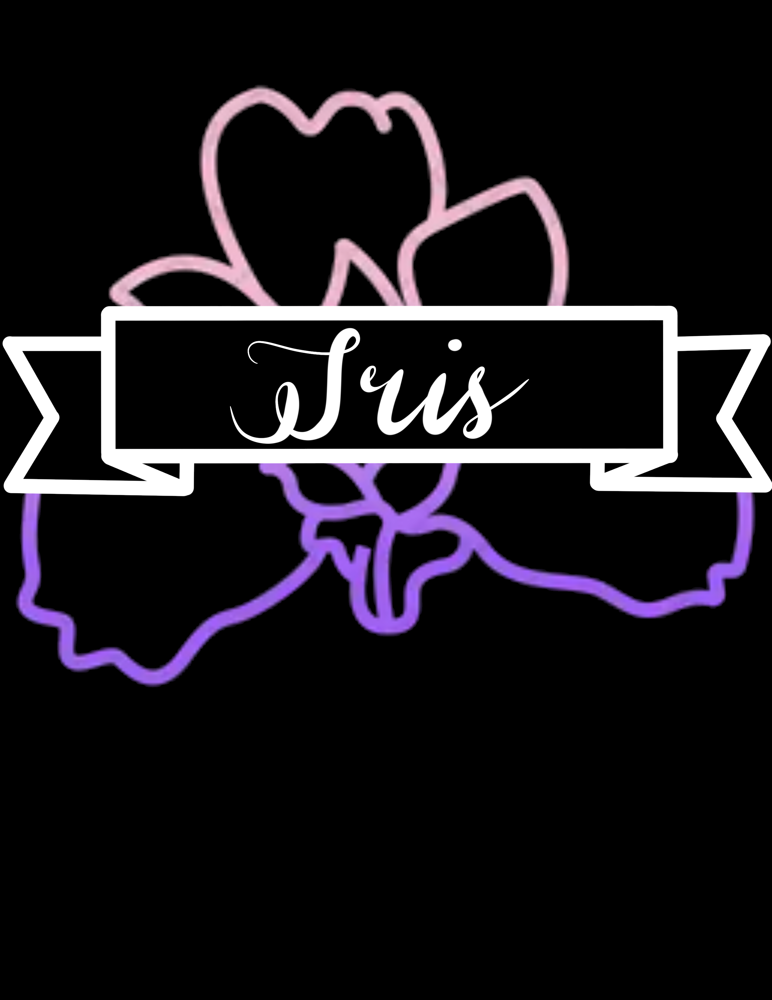
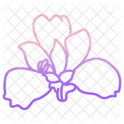
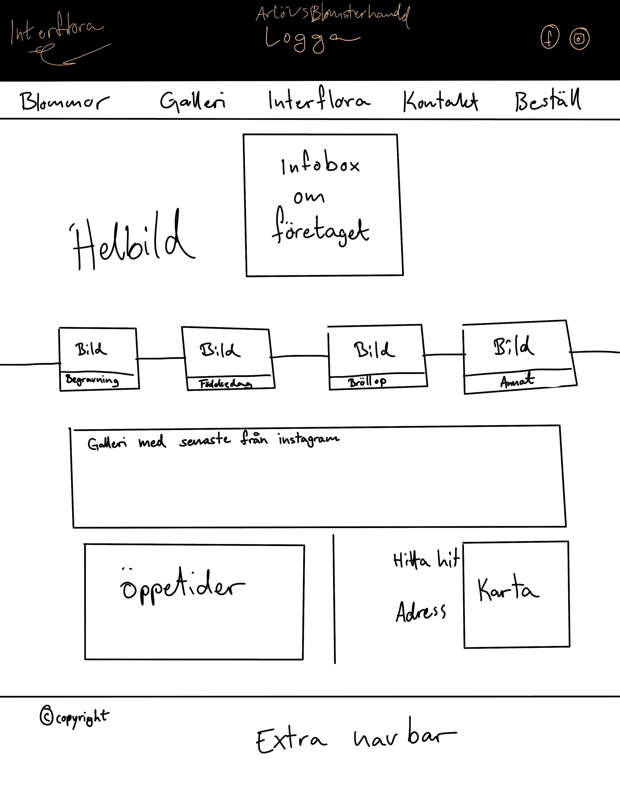
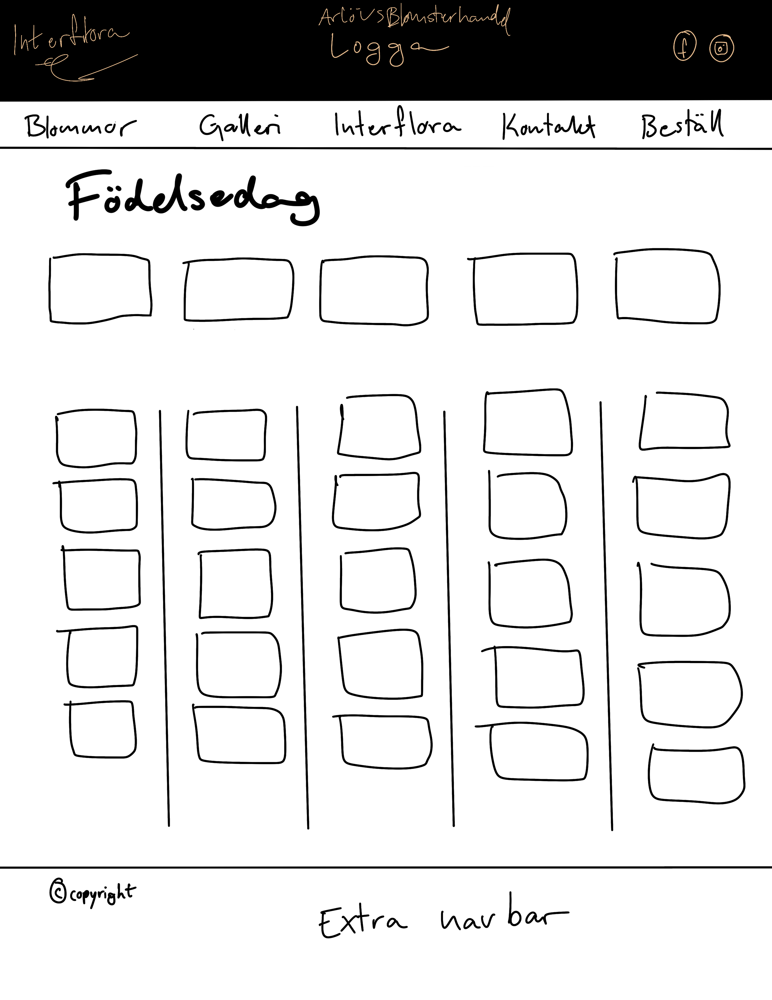
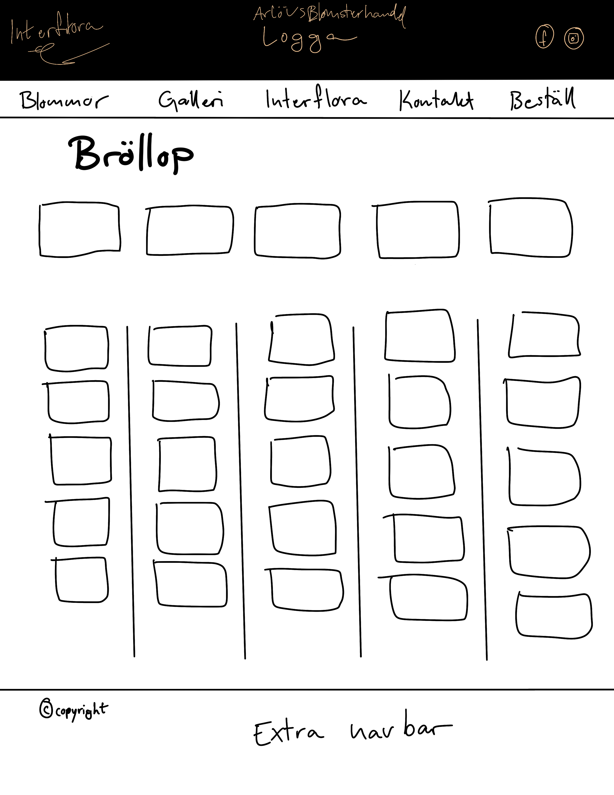
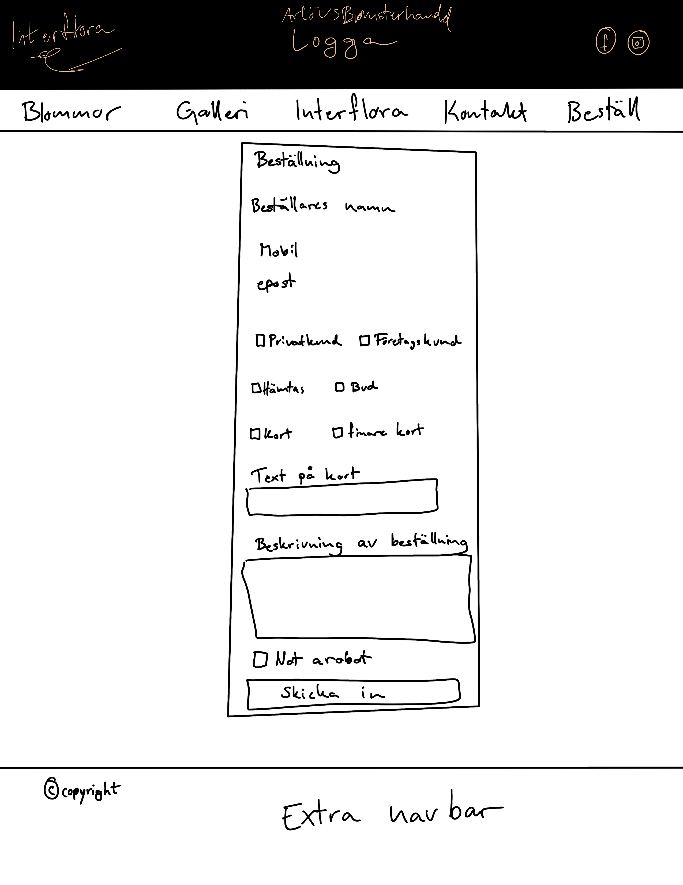
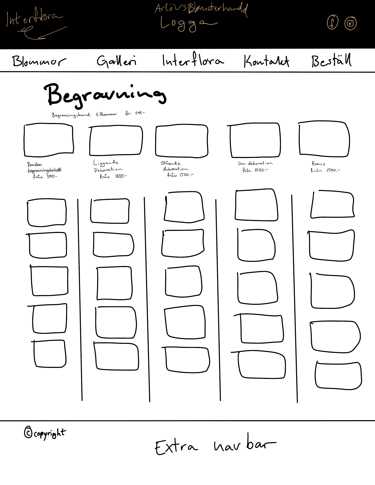
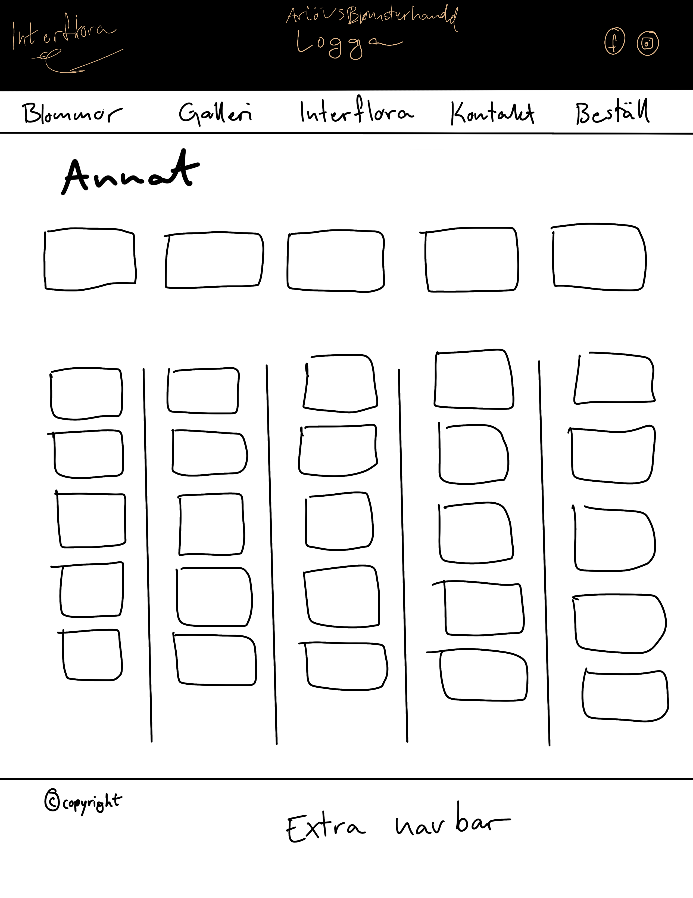

# Fyrklöver
# Fyrklöver
Välkommen till Iris Blommor 🌸
Om företaget
Vi binder blommor till alla livets tillfällen – begravningar, födelsedagar, bröllop och lite extra i vardagen.

Vi samarbetar med Blomstergrossisten (BGM) för att alltid kunna erbjuda säsongens finaste blommor. Genom vår anslutning till Interflora och Arlövs Blomsterhandel kan vi hjälpa dig oavsett var du befinner dig.

Vill du ha en bukett som ingen annan har? Berätta vilka blommor du gillar, vilka färger som passar och vad det är för tillfälle, så binder vi något unikt för just dig. Har du en bild, en favoritblomma eller bara en vag känsla? Vi hjälper dig hitta rätt.

Oavsett om du är privatperson i Malmö och omnejd eller företag som vill ha fina blommor på kontoret är vi här för dig. Vi hjälper dig gärna att välja blommor, färger och form så att arrangemanget passar både tillfället och mottagaren.

Medlemmar : Ahad, Johanna, Yoonis och Arslan

Länkar:
Github pages:https://ahadinho.github.io/java26-html-css-slutprojekt-Fyrklover/

Github : https://github.com/Ahadinho/java26-html-css-slutprojekt-Fyrklover

Github projects(kanban): https://github.com/users/Ahadinho/projects/1

Logga gjord av Johanna: 

Favicion gjord av Johanna: 

Skiss design av Johanna:

Kontakta oss iconer och Sociala medier iconer, och företag från Wikipedia

Bilder på blommor och bild på ägare från https://arlovsblomsterhandel.se/ : 

Några blider på blommor från olika sidor 

Kort om Mobilvy och Darkmode:

Layouten ändras med att allt blir mer kompakt och en Hamburgarmeny samlar ihop navigerinsmenyerna. Footer layouten tar allt från vänster till höger, och visar det från topp nedåt. Samma ändrig sker på kontakta oss sidan för kontaktinfon och hemsidans tillverkare. På beställ sidan så hamnar dem 4 små menyer under beställnings meny

Gällande Darkmode....

Ansvarsområden och jobb

Ahad:
Jobbat på Kontakt.html, README.md filen, Infogning av bilder på skiss, och lite hmtl för footer. Fixat Bootstrap responsive navbar för alla .html sidor, och lite CSS för Navbar

Yoonis:
Foundation
Header
Main (index.html, Galleri.html)
Footer
css och mobilvy för alla dessa

Johanna: 
Skapat skisser
Skapat loggan/favicon
Letade upp alla bilder
Letade upp länkar för samarbetspartners, facebook och instagram
Gjorde html och css för Beställ.html, annat.html, begravning.html, beställ.html, blommor.html, bröllop.html, födelsedag.html
Header och nav
gjorde css för kontakt.html
gjort hoppa-till knappar
jobbat med animationer.
har gjort automatisk darkmode.
gjort SEO

Arslan:
